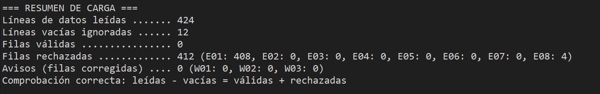

# Migración y auditoría de datos de restaurantes
Aplicación de consola en Java 25 que limpia un CSV de restaurantes con errores, mantiene los
datos limpios, los exporta a XML (con DOM), los vuelve a leer con DOM y SAX,
comprueba la integridad, genera estadísticas y compara el rendimiento de DOM vs SAX.
## Tecnologías
Java 25 · biblioteca estándar del JDK · DOM · SAX · E/S de ficheros en UTF-8 explícito para no depender de la plataforma
## Cómo ejecutarlo
Desde la raíz del proyecto (todas las rutas son relativas a ella):

```
javac -encoding UTF-8 -sourcepath src -d out src/com/app/Main.java
java -cp out com.app.Main
```

También puedes ejecutar `Main` desde tu IDE con el directorio de trabajo en la raíz.
El CSV de entrada está en: datos/restaurantes.csv; la opción 1 crea el resto de carpetas.

## Qué hace (menú)
| Opción | Función |
|-----|---|
| 1   | Prepara carpetas, comprueba el CSV de entrada y hace una copia con marca de tiempo |
| 2   | Carga y valida el CSV; genera el limpio, errores.txt y avisos.txt |
| 3   | Consultas con filtros por CP, tipo de cocina y puntuación |
| 4-6 | Añadir, modificar y eliminar con persistencia segura |
| 7   | Exporta a XML con DOM |
| 8-9 | Lee el XML con DOM y con SAX |
| 10  | Comprueba la integridad XML -> CSV, línea a línea |
| 11  | Estadísticas por provincia, tipo de cocina y tramos de puntuación |
| 12  | Compara el rendimiento de DOM y SAX con 50.000 registros |

## Reglas de validación (en este orden)
| Código | Tipo | Regla |
|-----|-------|---|
| E01 | Error | La línea no tiene 5 campos |
| E02 | Error | Nombre vacío |
| W01 | Aviso | CP de 4 dígitos: se antepone un 0 |
| E03 | Error | CP inválido (no son 5 dígitos o la provincia no está entre 01 y 52) |
| W02 | Aviso | Coma decimal en la puntuación: se cambia por punto |
| E04 | Error | La puntuación no es un número |
| E05 | Error | Puntuación fuera de [0, 10] |
| E06 | Error | Tipo de cocina vacío |
| W03 | Aviso | Tipo de cocina normalizado (Primera en mayúscula) |
| E07 | Error | Duplicado de nombre + dirección (se conserva el primero) |

Un error rechaza la fila; un aviso la corrige y la acepta.

Comprobación de cuadre: líneas de datos no vacías = válidas + rechazadas.


## Rendimiento: DOM frente a SAX (50.000 registros)
| Parser | Tiempo medio | Memoria |
|-----|-----------|---------|
| DOM | 296.37 ms | 12.69 MB|
| SAX | 124.52 ms | 0.0 MB  |

Equipo: CPU: Intel Core i7 10750H, RAM: 16GB DDR4, Java 25, Windows 10 

Tres ejecuciones por parser; se descarta la primera.
## Decisiones técnicas
- **Parser de CSV propio** en lugar de split(","): hay campos con comas y comillas duplicadas.
- **UTF-8 explícito** al leer y escribir: antes de Java 18 la codificación por defecto dependía del sistema e indicarla evita sorpresas.
- **Persistencia segura**: se escribe un .tmp, se copia el fichero actual a copias/ y solo
entonces se sustituye, comprobando lo que devuelven delete() y renameTo().
- **SAX**: characters() puede llamarse varias veces por elemento, así que acumulo en un StringBuilder.
- **Medición**: System.nanoTime(); se descarta la primera ejecución por el calentamiento de la JVM
(carga de clases y compilación JIT). System.gc() es solo una sugerencia, así que la memoria es aproximada.
## Origen del proyecto
Práctica de 2.º de DAM. Añadí la comparación de rendimiento entre DOM y SAX (opción 12).

## Qué mejoraría
- Tests automáticos (JUnit) de las reglas de validación E01-E07 y W01-W03.
- Rehacer la medición de rendimiento con más repeticiones y una medición de memoria fiable.